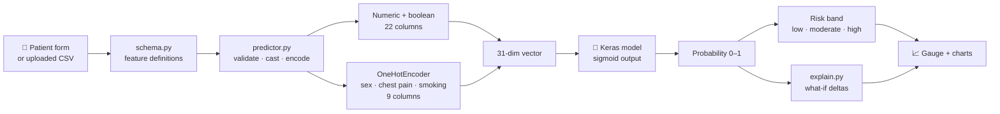
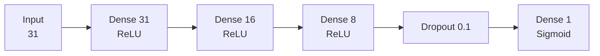

<div align="center">

# 🫀 Heart Attack Risk Predictor

### A bilingual (EN / فارسی) deep-learning web app that estimates heart-disease risk from 25 clinical, lab and lifestyle signals — with batch scoring, what-if explanations and a data explorer.

<p>
  
  
  
  
  
  
  
  
  
</p>

[Features](#-features) · [Quick start](#-quick-start) · [How it works](#-how-it-works) · [Model](#-the-model) · [Batch CSV](#-batch-prediction-csv-format) · [Deploy](#-deployment) · [Limitations](#-limitations--responsible-use)

</div>

> [!WARNING]
> **Educational use only.** This project is a machine-learning demo. It is **not a medical device**, has not been clinically validated, and must never be used to diagnose, treat or make decisions about a real patient. If you are worried about your heart health, contact a qualified clinician or your local emergency number.

---

## 📑 Table of contents

- [Overview](#-overview)
- [Features](#-features)
- [Quick start](#-quick-start)
- [How it works](#-how-it-works)
- [The model](#-the-model)
- [Input features](#-input-features)
- [Batch prediction (CSV format)](#-batch-prediction-csv-format)
- [Explainability: what-if analysis](#-explainability-what-if-analysis)
- [Project structure](#-project-structure)
- [Development & testing](#-development--testing)
- [Deployment](#-deployment)
- [Limitations & responsible use](#-limitations--responsible-use)
- [Compatibility & security notes](#-compatibility--security-notes)
- [Roadmap](#-roadmap)
- [Contributing](#-contributing)
- [License](#-license)

---

## 🧭 Overview

**Heart Attack Risk Predictor** wraps a small Keras neural network in a polished [Streamlit](https://streamlit.io) interface. You enter a patient profile (or upload a CSV of many), and the app returns the model's estimated **probability of heart disease**, a colour-coded risk gauge, and a chart showing which inputs pushed the estimate up or down.

The codebase is deliberately structured so the model, the feature pipeline and the UI cannot silently drift apart: a single `schema.py` defines every feature, and the test suite re-implements the training notebook's pre-processing and asserts the app produces an **identical `(n, 31)` matrix**.

| | |
|---|---|
| **Task** | Binary classification — `has_heart_disease` (0 / 1) |
| **Data** | 9,000 rows × 25 features (30.3 % positive class) |
| **Model** | Dense neural network (31 → 31 → 16 → 8 → 1) |
| **Hold-out accuracy** | ≈ 89.6 % (see [caveats](#-limitations--responsible-use)) |
| **UI languages** | English and Persian (with right-to-left layout) |

---

## ✨ Features

| | Feature | Details |
|---|---|---|
| 🩺 | **Single assessment** | Grouped input form (Profile · Vitals · Labs · Cardiac · Lifestyle), one-click example profiles (*typical / healthy / at-risk*), colour-coded gauge. |
| 🔍 | **"What influenced this?"** | Model-agnostic, one-at-a-time what-if analysis shown as a diverging bar chart (percentage-point impact per feature). |
| 📦 | **Batch prediction** | Upload a CSV → per-patient risk, summary metrics, downloadable results. CSV template included. |
| 🛡️ | **Strict validation** | Missing columns, empty cells, non-numeric values, unknown categories and ambiguous booleans all produce clear, human-readable errors. |
| 📊 | **Data explorer** | Class balance, per-feature distributions split by outcome, correlation heatmap. |
| 📖 | **About the model** | Architecture, the exact 31-element input vector, training setup and limitations, inside the app. |
| 🌍 | **Bilingual + RTL** | Full English / Persian UI with Vazirmatn font and RTL styling. |
| 🐳 | **Deployable** | Dockerfile with health check, Streamlit Cloud ready. |
| ✅ | **CI** | GitHub Actions runs `ruff` + `pytest` on Python 3.11 and 3.12 — **no TensorFlow needed** for tests. |

---

## 🚀 Quick start

```bash
# 1. Clone
git clone https://github.com/<your-username>/Heart_attack_predictor.git
cd Heart_attack_predictor

# 2. Create an isolated environment
python -m venv .venv
source .venv/bin/activate          # Windows: .venv\Scripts\activate

# 3. Install
pip install -r requirements.txt

# 4. Run
streamlit run app.py
```

Open **http://localhost:8501**.

> **Python:** 3.10 – 3.13 (upper bound set by TensorFlow). First launch loads the model once and caches it with `st.cache_resource`.

<details>
<summary><b>Run with Docker instead</b></summary>

```bash
docker build -t heart-risk-app .
docker run --rm -p 8501:8501 heart-risk-app
```

The image is based on `python:3.12-slim`, sets `KERAS_BACKEND=tensorflow` and includes a `HEALTHCHECK` against Streamlit's `/_stcore/health` endpoint.

</details>

---

## ⚙️ How it works



**Design principles**

- **Single source of truth.** `heart_app/schema.py` declares every feature once — type, UI range, default, EN/FA labels, help text — and the form, validation, presets and tests all derive from it.
- **Lazy TensorFlow.** Importing `predictor.py` does *not* import TensorFlow; the Keras model is only materialised inside `HeartRiskPredictor.load()`. Tests and CI stay lightweight.
- **Fail loudly.** At start-up the predictor compares the model's `INPUT_DIM` with the number of features the app builds and raises if they differ.
- **Training/serving parity.** Column order and one-hot ordering are locked by tests against the real dataset.

---

## 🧠 The model



| Item | Value |
|---|---|
| Framework | Keras 3 (TensorFlow backend) |
| Architecture | `Dense(31, relu) → Dense(16, relu) → Dense(8, relu) → Dropout(0.1) → Dense(1, sigmoid)` |
| Loss / optimiser | Binary cross-entropy / Adam |
| Callbacks | `EarlyStopping(monitor="val_loss", patience=50, restore_best_weights=True)`, `ReduceLROnPlateau(factor=0.4, min_lr=3e-4)` |
| Max epochs | 500 (training stopped at epoch 137; best weights from epoch 87) |
| Split | 70 % train (6,300) / 15 % test (1,350) / 15 % validation (1,350) |
| Input vector | 22 numeric/boolean features (CSV order) + one-hot of `smoker_status`, `chest_pain_type`, `sex` (3 + 4 + 2 = 9) = **31** |
| Output | Probability of `has_heart_disease` |

### Results (from the training notebook)

| Metric | Train | Test |
|---|---:|---:|
| Accuracy | 0.8995 | **0.8956** |
| Precision | – | 0.8557 |
| Recall (sensitivity) | – | 0.8009 |
| Specificity | – | 0.9386 |
| F1 | – | 0.8274 |

Test-set confusion matrix (1,350 patients):

|  | Predicted healthy | Predicted heart disease |
|---|---:|---:|
| **Actually healthy** | 871 | 57 |
| **Actually heart disease** | 84 | 338 |

> [!NOTE]
> A Random Forest was fitted in the notebook purely for exploratory feature importance. On that run the most important inputs were `max_heart_rate_achieved` (≈ 0.24), `exercise_induced_angina` (≈ 0.12) and `st_depression` (≈ 0.07). This is exploratory, not a clinical finding.

### Risk bands

| Band | Probability | Colour |
|---|---|---|
| Low | < 30 % | 🟢 |
| Moderate | 30 % – 60 % | 🟠 |
| High | ≥ 60 % | 🔴 |

The bands are **illustrative UI thresholds**, not clinically derived cut-offs.

---

## 🧬 Input features

25 inputs, grouped as in the UI. Ranges are the bounds used by the form.

<details open>
<summary><b>Show the full feature table</b></summary>

| Group | Feature | Type | Range / values |
|---|---|---|---|
| Profile | `age` | int | 18 – 90 |
| Profile | `sex` | category | Female, Male |
| Profile | `bmi` | float | 15.0 – 43.3 |
| Profile | `family_history` | bool | True / False |
| Profile | `smoker_status` | category | Never, Former, Current |
| Vitals | `resting_bp_systolic` | int | 85 – 181 mmHg |
| Vitals | `resting_bp_diastolic` | int | 50 – 126 mmHg |
| Vitals | `resting_heart_rate` | int | 48 – 111 bpm |
| Vitals | `max_heart_rate_achieved` | int | 93 – 210 bpm |
| Labs | `cholesterol_total` | int | 90 – 314 mg/dL |
| Labs | `hdl` | int | 18 – 110 mg/dL |
| Labs | `ldl` | int | 35 – 207 mg/dL |
| Labs | `triglycerides` | int | 35 – 390 mg/dL |
| Labs | `fasting_blood_sugar` | int | 60 – 204 mg/dL |
| Labs | `hba1c` | float | 4.0 – 8.6 % |
| Cardiac | `chest_pain_type` | category | Asymptomatic, Atypical Angina, Non-Anginal Pain, Typical Angina |
| Cardiac | `exercise_induced_angina` | bool | True / False |
| Cardiac | `st_depression` | float | 0.0 – 6.5 mm |
| Lifestyle | `alcohol_units_per_week` | float | 0.0 – 45.9 |
| Lifestyle | `exercise_minutes_per_week` | int | 0 – 366 |
| Lifestyle | `sleep_hours` | float | 3.1 – 11.0 |
| Lifestyle | `stress_score` | float | 0 – 100 |
| Lifestyle | `wearable_owner` | bool | True / False |
| Lifestyle | `daily_steps` | int | 500 – 13,950 |
| Lifestyle | `diet_quality_score` | float | 4.8 – 100 |

</details>

---

## 📦 Batch prediction (CSV format)

In the **Batch prediction** tab, download the CSV template, fill in one row per patient, and upload it (max **20 MB**, configured in `.streamlit/config.toml`).

```csv
age,sex,resting_bp_systolic,resting_bp_diastolic,cholesterol_total,hdl,ldl,triglycerides,fasting_blood_sugar,hba1c,bmi,resting_heart_rate,max_heart_rate_achieved,chest_pain_type,exercise_induced_angina,st_depression,family_history,smoker_status,alcohol_units_per_week,exercise_minutes_per_week,sleep_hours,stress_score,wearable_owner,daily_steps,diet_quality_score
60,Male,133,84,197,51,114,159,126,6.0,26.7,83,146,Asymptomatic,TRUE,1.2,FALSE,Never,4.5,114,6.9,50.3,FALSE,5708,55.8
```

**Rules enforced by the validator**

- All 25 columns must be present (extra columns, including the target, are ignored).
- No empty cells.
- Numeric columns must be numeric.
- Boolean columns accept `true/false`, `1/0`, `yes/no`, `y/n`, `t/f` (case-insensitive).
- Categorical columns must exactly match the categories seen in training (e.g. `sex` ∈ {`Female`, `Male`}); anything else raises an error that lists the allowed values.

The output file contains your original columns plus the predicted probability and risk band, and can be downloaded as CSV.

---

## 🔬 Explainability: what-if analysis

For a single patient, `heart_app/explain.py` answers: *"How much would the estimated risk change if this one value were typical?"*

1. Build the patient's baseline probability.
2. For each of the 25 features, replace **only that feature** with the reference value (dataset median / mode, stored as `Feature.default`).
3. Run **one batched** model call for all 26 variants.
4. `delta = baseline − variant` — positive means the patient's value **raises** the estimate versus a typical patient.

```text
delta > 0  →  this value pushes risk UP   (red bar)
delta < 0  →  this value pushes risk DOWN (green bar)
```

> [!IMPORTANT]
> This is a fast, model-agnostic *approximation* (one-at-a-time perturbation, no interaction effects). It describes the **model's behaviour**, not medical causation.

---

## 🗂️ Project structure

```text
.
├── app.py                      # Streamlit entry point (4 tabs, sidebar, state)
├── heart_app/
│   ├── __init__.py             # package version
│   ├── schema.py               # feature definitions, ranges, presets, risk bands
│   ├── predictor.py            # artifact loading, validation, feature engineering
│   ├── explain.py              # what-if contribution analysis
│   ├── charts.py               # Plotly gauge + contribution chart
│   └── i18n.py                 # English / Persian strings
├── artifacts/
│   ├── Model.pkl               # trained Keras model
│   ├── OneHotEncoder.pkl       # fitted scikit-learn encoder
│   └── Config.pkl              # INPUT_DIM + training hyper-parameters
├── data/Data.csv               # training data (9,000 rows)
├── notebooks/                  # training notebook (Heart_Atack_Predictor.ipynb)
├── tests/test_predictor.py     # pytest suite (stub model, no TensorFlow)
├── .streamlit/config.toml      # theme, upload limit, telemetry off
├── .github/workflows/ci.yml    # ruff + pytest on Python 3.11 / 3.12
├── Dockerfile
├── pyproject.toml              # ruff + pytest configuration
├── requirements.txt            # runtime dependencies
└── requirements-dev.txt        # lightweight test/CI dependencies
```

> [!IMPORTANT]
> The code resolves the dataset at `data/Data.csv` (lowercase). On case-sensitive file systems (Linux, Docker, Streamlit Cloud) make sure the folder is named exactly `data/`, otherwise the Data-explorer tab will be empty and the data-dependent tests will be **skipped**.

---

## 🛠️ Development & testing

```bash
pip install -r requirements-dev.txt

ruff check .        # lint (E, F, I, B, UP; line length 100)
pytest -q           # run tests
```

The suite uses a deterministic `StubModel`, so it runs in seconds without TensorFlow. It verifies that:

- the schema matches the CSV header exactly;
- the app's feature matrix equals the notebook's pipeline output `(n, 31)`;
- every default and preset lies inside the declared ranges and covers every feature;
- single and batch predictions return the right shapes and valid probabilities;
- string booleans are accepted and invalid input raises the right `PredictionInputError`;
- what-if contributions are sorted by magnitude and vanish for the reference profile;
- risk bands map correctly.

CI (`.github/workflows/ci.yml`) runs the same two commands on every push to `main` and every pull request.

### Retraining the model

1. Open the notebook in `notebooks/` and run it from the folder containing `Data.csv`.
2. Keep the preprocessing order intact: non-categorical columns in CSV order, then `OneHotEncoder(smoker_status, chest_pain_type, sex)`.
3. Overwrite `Model.pkl`, `OneHotEncoder.pkl`, `Config.pkl` in `artifacts/`.
4. Run `pytest` — it will fail loudly if the input dimension or column order no longer matches.

---

## ☁️ Deployment

**Streamlit Community Cloud** — push to GitHub → *New app* → choose the repo, branch and `app.py` → under *Advanced settings* select **Python 3.12**.

**Docker** — see [Quick start](#-quick-start). Any container platform (Cloud Run, Fly.io, Azure Container Apps, ECS…) can run the image; expose port `8501`.

---

## ⚠️ Limitations & responsible use

Please read these before drawing any conclusion from the numbers:

- **Not clinically validated.** No external validation, calibration analysis or fairness audit has been done.
- **Data provenance is undocumented.** The origin and collection method of `Data.csv` aren't described in this repository. Verify it before relying on any conclusion, and note that a high score on one dataset says little about real-world performance.
- **Metrics are slightly optimistic.** In the notebook, early stopping and the learning-rate scheduler monitored the same split that is later reported as the "test" set; the separate validation split that was created is not used. For an unbiased estimate, re-evaluate on a truly untouched hold-out set.
- **Not fully reproducible.** The notebook sets no random seed, so retraining gives slightly different weights and metrics.
- **Recall is 80 %.** On the reported test set, roughly 1 in 5 positive cases was missed — unacceptable for a screening tool.
- **Probabilities are uncalibrated.** A displayed "70 %" is a model score, not a 70 % real-world chance.
- **Explanations are approximate.** One-at-a-time what-if analysis ignores feature interactions and is not causal.
- **Minor notebook inconsistency.** `Config.pkl` records `DROPOUT = 0.01`, while the model itself uses `Dropout(0.1)`. The model architecture is authoritative.

---

## 🔐 Compatibility & security notes

- `Model.pkl` was saved with **Keras 3.15.1** and `OneHotEncoder.pkl` with **scikit-learn 1.9.0**. If loading fails after deployment, pin the versions you trained with:
  ```bash
  pip freeze | grep -iE "keras|tensorflow|scikit-learn"
  ```
  and copy them into `requirements.txt`.
- The artifacts are Python **pickles**, which can execute arbitrary code when loaded. **Only load files you created or fully trust.** For long-term use, consider exporting the model as `.keras` and the encoder via [`skops`](https://skops.readthedocs.io).
- The app collects no telemetry (`gatherUsageStats = false`) and keeps entered data in the Streamlit session only. Uploaded CSVs are processed in memory.

---

## 🗺️ Roadmap

- [ ] Migrate artifacts to `.keras` + `skops` (remove pickle risk)
- [ ] Proper train / validation / test protocol with fixed seeds
- [ ] Probability calibration (Platt / isotonic) and reliability plot
- [ ] SHAP-based explanations alongside the what-if chart
- [ ] Cross-validation and baseline comparison (logistic regression, gradient boosting)
- [ ] Model card documenting data source, intended use and subgroup performance
- [ ] Add a CI badge and a screenshot / demo GIF to this README

---

## 🤝 Contributing

Contributions are welcome.

1. Fork the repo and create a branch: `git checkout -b feat/my-change`
2. Make your change and add tests where relevant
3. Run `ruff check .` and `pytest -q`
4. Open a pull request describing *what* and *why*

If you add or rename a feature, update **only** `heart_app/schema.py` (and translations in `i18n.py`); the rest of the app and the tests follow the schema.

---

## 📄 License

Released under the **MIT License** — see [LICENSE](LICENSE). Remember to replace `YOUR NAME` in the license file with your own name.

<div align="center">

<sub>Built with Streamlit, Keras and Plotly. Made for learning — not for diagnosis. ❤️</sub>

</div>
